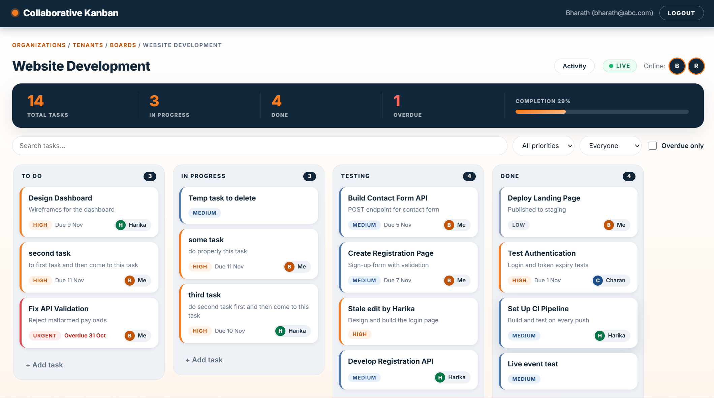
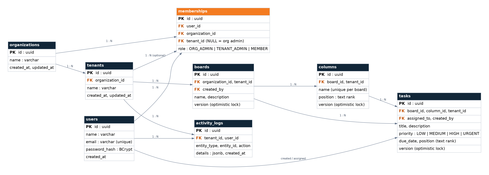
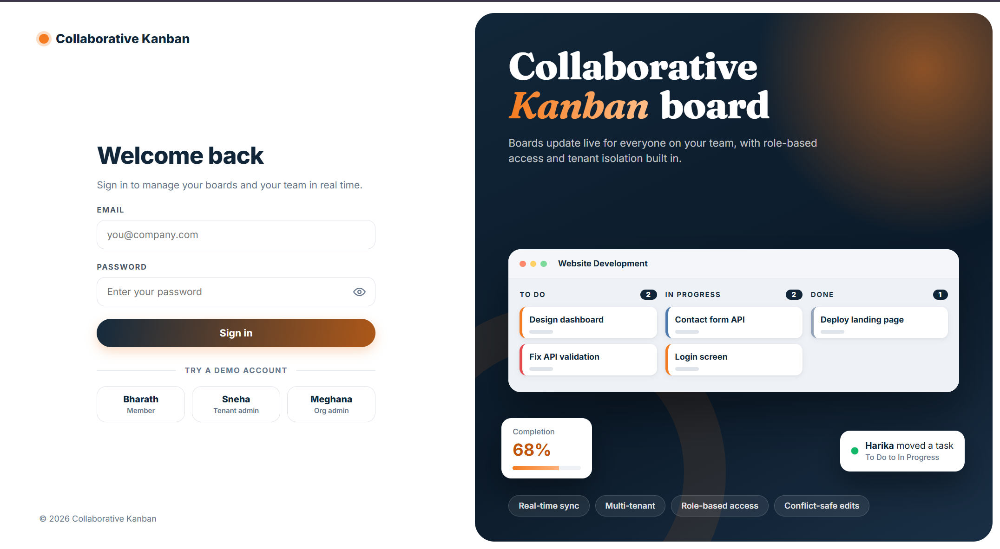
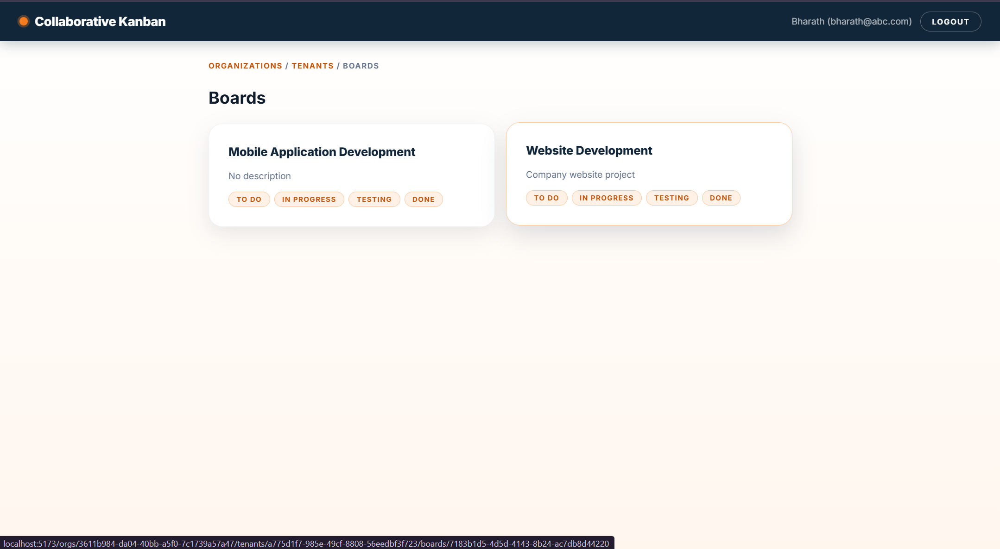
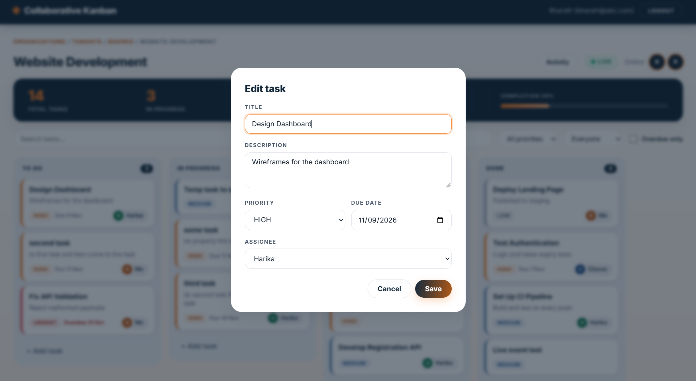
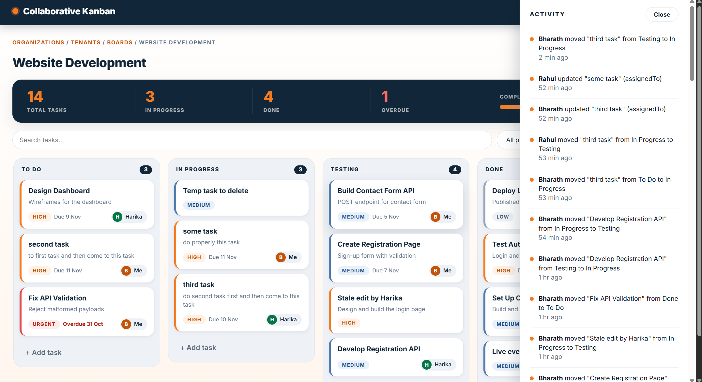

# Collaborative Kanban

A real-time, multi-organization, multi-tenant Kanban board. Teams organize work on boards, drag tasks between columns, and see each other's changes instantly. Every organization and every tenant (branch) is isolated from the others, and what a user can do depends on their role.



## Features

**Collaboration**
- Real-time updates over WebSocket (STOMP): task create, edit, move, delete and column or board changes appear on every open screen without a refresh
- Live presence: see who is online in the tenant
- Activity feed: who did what and when, updated live
- Drag and drop between and within columns, saved on the server

**Multi-tenancy and security**
- Organizations contain tenants (for example ABC Technologies has Hyderabad, Bangalore and Chennai)
- Three roles: `ORG_ADMIN`, `TENANT_ADMIN`, `MEMBER`
- Tenant isolation enforced in three layers: application checks, composite foreign keys, and PostgreSQL Row-Level Security
- JWT authentication, BCrypt password hashing, no secrets in the repository

**Data integrity**
- Optimistic locking on tasks, columns and boards: if two people edit the same item, the second save gets a `409 Conflict` and the UI reloads the latest data
- Position ordering with string ranks, so reordering never rewrites a whole column

**Interface**
- Organization and tenant switcher in the header
- Board, column and task management (create, edit, delete) with role-aware controls
- Task details: priority, due date, assignee, overdue highlighting
- Board stats strip, search and filters (priority, assignee, overdue)
- Split-screen login with one-click demo accounts

## Tech stack

| Layer | Technology |
|---|---|
| Backend | Java 17, Spring Boot 4.1 (Web MVC, Data JPA, Security, Validation, WebSocket), JJWT |
| Database | PostgreSQL 14+ (tested on 16), Row-Level Security |
| Frontend | React (Vite), React Router, Axios, `@hello-pangea/dnd`, `@stomp/stompjs` |
| Realtime | STOMP over WebSocket |
| Build | Maven wrapper (`mvnw`), npm |

## Architecture

```
Browser (React)  --REST /api-->   Spring Boot (port 5000)  --JDBC-->  PostgreSQL
                 <--STOMP /ws-->  (JWT filter, services,              (RLS per tenant)
                                   event publisher)
```

**Tenant isolation, three layers**

1. **Application:** every request carries a JWT. The service layer checks the user's membership for the organization and tenant before touching data.
2. **Schema:** composite foreign keys make cross-tenant links impossible (a task cannot point at a column from another board or tenant).
3. **Row-Level Security:** each transaction sets `app.current_tenant`; PostgreSQL policies hide rows from other tenants. The app connects as a non-superuser role (`kanban_app`) so the policies always apply.

**Roles and permissions**

| Action | MEMBER | TENANT_ADMIN | ORG_ADMIN |
|---|---|---|---|
| View boards and tasks of their tenant | yes | yes | yes (all tenants of the org) |
| Create, edit, move tasks | yes | yes | yes |
| Delete a task | only tasks they created | any | any |
| Create, edit, delete boards | no | yes | yes |
| Add, rename, delete columns (a column must be empty to be deleted) | no | yes | yes |

An organization-level admin has a membership with `tenant_id = NULL` and can access every tenant in that organization.

## Project structure

```
collaborative-kanban
  backend/            Spring Boot application (REST, WebSocket, security)
  frontend/           React application (Vite)
  database/
    schema.sql        Tables, enums, indexes, triggers, RLS policies, app role
    seed.sql          Demo organizations, tenants, users, boards, tasks
  docs/
    ER_DIAGRAM.md     ER diagram (Mermaid) and design notes
    er-diagram.png    ER diagram image
    screenshots/      Screenshots used in this README
  .env.example        Template for backend/.env
```

## Getting started

### Prerequisites

- Java 17
- Node.js 18 or newer
- PostgreSQL 14 or newer (with `psql` available)

### 1. Create the database

Run these from the project root. Replace the password with your own.

```bash
psql -U postgres -c "CREATE DATABASE collaborative_kanban;"
psql -U postgres -d collaborative_kanban -f database/schema.sql
psql -U postgres -d collaborative_kanban -c "ALTER ROLE kanban_app WITH PASSWORD 'your-db-password';"
psql -U postgres -d collaborative_kanban -f database/seed.sql
```

`schema.sql` creates the tables, RLS policies and the application role `kanban_app`. `seed.sql` adds the demo data and enables the `pgcrypto` extension, so run it as a superuser such as `postgres`. The seed script is safe to run twice.

### 2. Configure the backend

Copy `.env.example` to `backend/.env` and fill in real values:

```
DB_PASSWORD=your-db-password
JWT_SECRET=a-long-random-string-of-at-least-32-characters
```

`DB_PASSWORD` must match the password you set for the `kanban_app` role. `backend/.env` is ignored by Git and must never be committed.

### 3. Run the backend (port 5000)

Run it from the `backend` folder so the `.env` file is found.

```bash
cd backend
mvnw.cmd spring-boot:run        # Windows
./mvnw spring-boot:run          # macOS / Linux
```

Check that it is up: <http://localhost:5000/api/health>

### 4. Run the frontend (port 5173)

```bash
cd frontend
npm install
npm run dev
```

Open <http://localhost:5173>. The dev server proxies `/api` to the backend; the WebSocket connects to `ws://localhost:5000/ws`.

## Demo accounts

All demo accounts use the password `Password@123` (on a database created with `seed.sql`).

| User | Email | Organization / Tenant | Role |
|---|---|---|---|
| Rahul | rahul@abc.com | ABC Technologies (all tenants) | ORG_ADMIN |
| Harika | harika@abc.com | ABC / Hyderabad | TENANT_ADMIN |
| Charan | charan@abc.com | ABC / Hyderabad | MEMBER |
| Bharath | bharath@abc.com | ABC / Hyderabad | MEMBER |
| Sneha | sneha@abc.com | ABC / Bangalore | TENANT_ADMIN |
| Sai Kiran | saikiran@abc.com | ABC / Bangalore | MEMBER |
| Meghana | meghana@xyz.com | XYZ Solutions (all tenants) | ORG_ADMIN |
| Sunny | sunny@xyz.com | XYZ / Mumbai | MEMBER |

**Seed data:** ABC Technologies (Hyderabad, Bangalore, Chennai) and XYZ Solutions (Mumbai, Pune), five boards and about twenty tasks, some of them overdue.

### Things to try

1. Sign in as **Bharath** in one window and **Rahul** in a private window, and open the same board. Move a task in one window and watch it move in the other. Both users appear in the presence list.
2. As Bharath, notice there are no board or column management buttons (he is a `MEMBER`). As Rahul, add a column, rename it, and try to delete a column that still has tasks.
3. Open the same task in both windows, save in the first, then in the second. The second save is rejected with a conflict notice and the board reloads.
4. As Bharath, try to open a Bangalore board URL directly: access is denied. As Meghana, ABC Technologies never appears.

## API reference

All endpoints except `register`, `login` and `health` need `Authorization: Bearer <token>`. Paths below are relative to `/api`.

| Method | Path | Description |
|---|---|---|
| POST | `/auth/register` | Create an account |
| POST | `/auth/login` | Returns `token`, `userId`, `name`, `email` |
| GET | `/auth/me` | Current user |
| GET | `/health` | Health check |
| GET, POST | `/organizations` | List my organizations, create one |
| PUT, DELETE | `/organizations/{orgId}` | Update, delete |
| GET, POST | `/organizations/{orgId}/tenants` | List accessible tenants, create |
| PUT, DELETE | `/organizations/{orgId}/tenants/{tenantId}` | Update, delete |
| GET, POST | `.../tenants/{tenantId}/members` | List members (name, role), add a member |
| GET | `.../tenants/{tenantId}/presence` | Users currently online |
| GET | `.../tenants/{tenantId}/activity?limit=50` | Activity feed |
| GET, POST | `.../tenants/{tenantId}/boards` | List boards (with columns), create board |
| GET, PUT, DELETE | `.../boards/{boardId}` | Read, update (`expectedVersion`), delete |
| POST | `.../boards/{boardId}/columns` | Create column |
| PUT, DELETE | `.../boards/{boardId}/columns/{columnId}` | Rename (`expectedVersion`), delete (must be empty) |
| GET, POST | `.../boards/{boardId}/tasks` | List tasks, create task |
| GET, PUT, DELETE | `.../boards/{boardId}/tasks/{taskId}` | Read, update (`expectedVersion`), delete |
| PATCH | `.../boards/{boardId}/tasks/{taskId}/move` | Move or reorder a task |

**Move a task**

```json
PATCH .../tasks/{taskId}/move
{
  "toColumnId": "…",
  "prevTaskId": "…",      // neighbour above the drop position, or null
  "nextTaskId": "…",      // neighbour below the drop position, or null
  "expectedVersion": 3
}
```

The server calculates the new position between the two neighbours.

**Status codes**

| Code | Meaning |
|---|---|
| 400 | Validation error (for example blank title) |
| 401 | Missing or invalid token |
| 403 | No access to this organization or tenant, or role not allowed |
| 404 | Resource not found |
| 409 | Version conflict, duplicate column name, or deleting a column that still has tasks |

## Real-time events (WebSocket)

- **Endpoint:** `ws://localhost:5000/ws` (plain STOMP, not SockJS)
- **Authenticate:** send `Authorization: Bearer <token>` in the STOMP `CONNECT` headers
- **Subscribe:** `/topic/tenants/{tenantId}` (you must have access to the tenant)
- Subscribing marks the user as online for that tenant; disconnecting marks them offline

Each message has a `type`, the `boardId` it belongs to (null for presence), the `actorId` of the user who caused it, and a `data` payload.

| Event type | Payload (`data`) |
|---|---|
| `task:created`, `task:updated`, `task:moved` | `task` (full task object) |
| `task:deleted` | `taskId` |
| `column:created`, `column:updated` | `column` |
| `column:deleted` | `columnId`, `boardId` |
| `board:created`, `board:updated` | `board` |
| `board:deleted` | `boardId` |
| `presence:online`, `presence:offline` | `userId`, `name` |

The actor receives their own events too. The client applies updates by `version`, so duplicates and out-of-order events are ignored safely.

## Database

The full schema is in [`database/schema.sql`](database/schema.sql). Eight tables: `organizations`, `tenants`, `users`, `memberships`, `boards`, `columns`, `tasks`, `activity_logs`.



More detail and design notes: [`docs/ER_DIAGRAM.md`](docs/ER_DIAGRAM.md).

## Screenshots

| Login | Boards |
|---|---|
|  |  |

| Task details | Activity feed |
|---|---|
|  |  |

## Troubleshooting

| Problem | Likely cause and fix |
|---|---|
| `Could not resolve placeholder 'DB_PASSWORD'` | `backend/.env` is missing, misnamed (for example `.env.txt`), or the backend was started outside the `backend` folder |
| `password authentication failed for user "kanban_app"` | `DB_PASSWORD` does not match the role password. Run the `ALTER ROLE` command from step 1 |
| Login page shows a network error | Backend is not running on port 5000 |
| `401` after changing `JWT_SECRET` | Old tokens are invalid. Sign out and sign in again |
| Empty board list for every user | The seed script was not run, or ran against another database |
| `could not open extension control file … pgcrypto` | Install the PostgreSQL contrib package, or run `seed.sql` as a superuser |

## Security notes

- Passwords are stored as BCrypt hashes.
- `DB_PASSWORD` and `JWT_SECRET` come from environment variables or `backend/.env`; there are no defaults in the code, and `.env` is Git-ignored.
- The application database role is not a superuser, so Row-Level Security cannot be bypassed by the app.
- The demo password `Password@123` is for local demos only.
