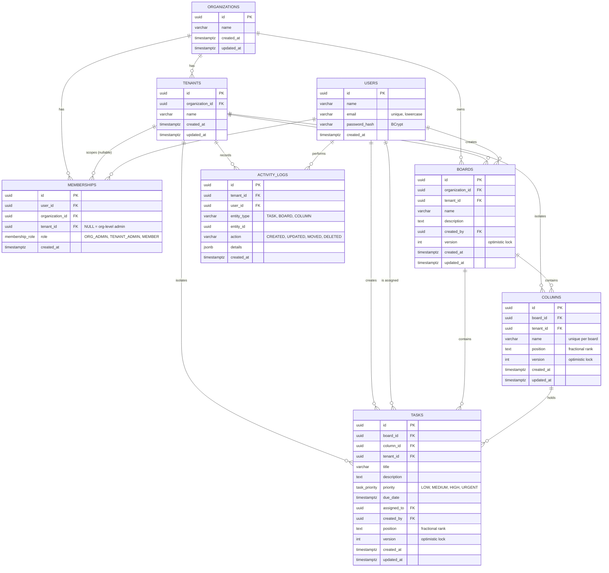

# Database ER Diagram

## Design notes

**Multi-tenancy.** An organization contains tenants (for example ABC Technologies has Hyderabad, Bangalore and Chennai). Every tenant-owned table (`boards`, `columns`, `tasks`, `activity_logs`) carries a `tenant_id`. PostgreSQL Row Level Security policies filter rows with the `app.current_tenant` setting, which the backend sets inside each transaction (`TenantContext.apply`). Even a buggy query cannot read another tenant's data.

**Roles.** `memberships.role` is one of `ORG_ADMIN`, `TENANT_ADMIN`, `MEMBER`. An organization-level admin has a membership row with `tenant_id = NULL` and can access every tenant in that organization. Tenant admins and members have a membership tied to one tenant.

**Optimistic locking.** `boards`, `columns` and `tasks` have a `version` column. Update and move requests send `expectedVersion`; a mismatch returns HTTP 409 and the UI reloads the latest data.

**Ordering.** `columns.position` and `tasks.position` are zero-padded text ranks (for example `0001000`). A drag and drop inserts a rank between the previous and next neighbour, so reordering never rewrites the whole list.

**Audit trail.** `activity_logs` stores who did what (`entity_type`, `action`, JSON `details`), written in the same transaction as the change, and powers the Activity panel.
